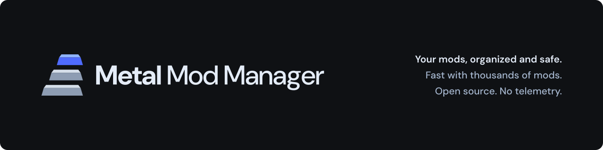

<picture>
  <source media="(prefers-color-scheme: dark)" srcset="branding/github-banner-dark.png">
  <source media="(prefers-color-scheme: light)" srcset="branding/github-banner-light.png">
  
</picture>

A free, open-source mod manager for PC games, for Windows and Linux.

Metal Mod Manager is a community fork of the [Nexus Mods App](https://github.com/Nexus-Mods/NexusMods.App), which Nexus Mods stopped developing and archived in early 2026. It is **not affiliated with or endorsed by Nexus Mods**.

> **Status:** early development, not ready for everyday use. There are no releases yet.

## What is different from the Nexus Mods App

- **No telemetry.** All usage tracking and metrics sent to Nexus Mods are removed, as are the tracking parameters on nexusmods.com links.
- **Leaves your download links alone.** The app does not take over `nxm://` links from Vortex or other managers. You can turn this on in Settings. Signing in to Nexus Mods borrows the link handler only for the sign-in, then gives it back.
- **Its own identity.** It uses its own name, executable (`MetalModManager`), data folder and registry entries, so it can sit next to a Nexus Mods App install without sharing data.
- **Fixes for the archived code.** Two startup crashes on the final upstream commit are fixed.

## Building from source

Requires the [.NET 9 SDK](https://dotnet.microsoft.com/download).

```sh
git clone --recurse-submodules https://github.com/grvsmalik/Metal-Mod-Manager.git
cd Metal-Mod-Manager
dotnet build src/NexusMods.App/NexusMods.App.csproj
dotnet run --project src/NexusMods.App
```

On Windows, enable long paths (`git config core.longpaths true`) before cloning; some files have long names.

Debug builds show every game the code supports, including ones upstream marked as unsupported.

## Credits and licence

Metal Mod Manager is built on the work of the Nexus Mods App team and its contributors. The project and namespace names (`NexusMods.*`) are kept from upstream so that fixes can still be shared between forks.

Licensed under the [GNU General Public License v3.0](LICENSE.md), like the original. The Metal Mod Manager name and logo in [`branding/`](branding/) are not covered by the GPL; see [branding/README.md](branding/README.md). The fork point is tagged `upstream-base`, and the original repository is the `upstream` remote.
